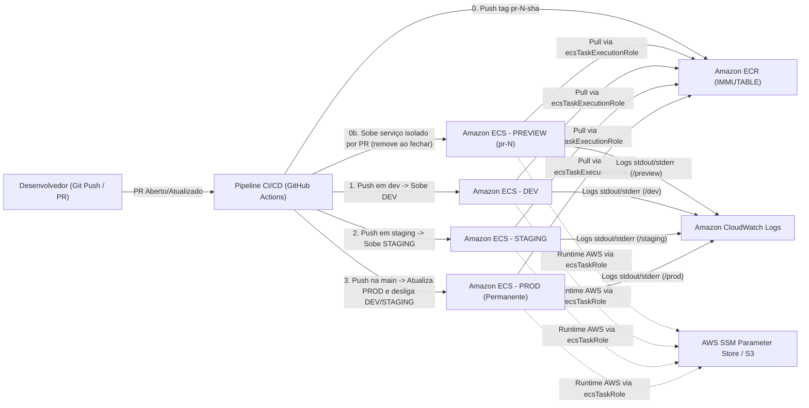

# Arquitetura Multi-Ambiente na AWS (Preview por PR, Dev, Staging e Prod) com ECS, ECR e IAM

Repositório de portfólio focado em **Cloud Architecture, DevSecOps e FinOps na AWS**, demonstrando como construir um ciclo completo de entrega contínua com **artefatos imutáveis no Amazon ECR**, **ambientes de `preview` isolados por Pull Request**, **ambientes de `dev` e `staging` no Amazon ECS (Fargate)**, **produção permanente** e **segregação estrita das três identidades IAM**.

---

## Visão Geral da Arquitetura

Este projeto resolve quatro desafios clássicos de engenharia de plataforma:
1. **Imutabilidade de Artefatos ("Build Once, Deploy Anywhere")**: imagens geradas com tag única (`app:pr-<numero>-<short_sha>`, `app:dev-<short_sha>`, `app:staging-<short_sha>`) não são sobrescritas no ECR.
2. **Trabalho Paralelo em Equipe (Preview por Pull Request)**: cada PR aberto gera seu próprio serviço ECS isolado (`aws-ecs-ephemeral-environments-pr-<numero>-service`) com link público exclusivo comentado automaticamente no PR, permitindo que vários desenvolvedores validem suas features na AWS ao mesmo tempo sem conflito.
3. **FinOps com Ambientes Efêmeros**: `preview` é destruído ao fechar/mergear o PR, e `dev` e `staging` são desligados (`desired-count = 0`) automaticamente quando a `main` atualiza produção, evitando custos de computação ociosos.
4. **Observabilidade e Auditoria Contínuas**: mesmo após o encerramento ou remoção dos serviços de `preview`, `dev` e `staging`, as imagens permanecem armazenadas no **Amazon ECR** e todo o fluxo de `stdout`/`stderr` permanece salvo no **Amazon CloudWatch Logs**.



---

## As 3 Identidades IAM da Arquitetura

A separação rigorosa de privilégios garante que **a pipeline**, **o agente de infraestrutura do ECS** e **o código da aplicação** nunca compartilhem permissões entre si:

| Identidade IAM | Recurso no Terraform | Quem Utiliza | Responsabilidades Principais |
| :--- | :--- | :--- | :--- |
| **Identidade do Pipeline (CI/CD)** | `aws-ecs-ephemeral-environments-cicd-pipeline-user` (`infra/terraform/iam.tf`) | GitHub Actions via **Chaves Estáticas** (`AWS_ACCESS_KEY_ID` / `AWS_SECRET_ACCESS_KEY`) | Faz o build da imagem Docker, envia com tag única para o **ECR**, registra revisões da Task Definition, cria/atualiza Services/Tasks em `dev`, `staging` e `prod`, e **encerra `dev`/`staging`** ao final dos testes. Possui `iam:PassRole` restrito exclusivamente às duas roles do ECS. |
| **ECS Task Execution Role (`ecsTaskExecutionRole`)** | `aws-ecs-ephemeral-environments-<env>-ecsTaskExecutionRole` (`infra/terraform/iam.tf`) | Agente do ECS / Infraestrutura Fargate (**Control Plane**) | Puxar a imagem privada do **Amazon ECR** (`ecr:GetAuthorizationToken`, `ecr:BatchGetImage`) e enviar os fluxos `stdout`/`stderr` do container para o **Amazon CloudWatch Logs** (`logs:CreateLogStream`, `logs:PutLogEvents`). |
| **ECS Task Role (`ecsTaskRole`)** | `aws-ecs-ephemeral-environments-<env>-ecsTaskRole` (`infra/terraform/iam.tf`) | Código da aplicação dentro do container (**Data Plane / Runtime**) | Acessar recursos AWS necessários ao negócio em tempo de execução (ex.: leitura de parâmetros no **SSM Parameter Store** `/aws-ecs-ephemeral-environments/<env>/*` e objetos no **Amazon S3** do respectivo ambiente), sem acesso ao ECR ou ao control plane do ECS. |

---

## Visão Geral do Fluxo (`Preview por PR` → `dev` → `staging` → `main`)

1. **Pull Request Aberto ou Atualizado (`preview`)**:
   - Quando um desenvolvedor abre ou atualiza um PR para `dev`, `staging` ou `main`, o job `deploy-preview` gera a imagem imutável `app:pr-<numero>-<short_sha>` no **Amazon ECR**, registra uma Task Definition dedicada ([ecs/task-definition.preview.json](ecs/task-definition.preview.json)) e cria um serviço ECS exclusivo (`aws-ecs-ephemeral-environments-pr-<numero>-service`) no cluster `aws-ecs-ephemeral-environments-preview-cluster`.
   - Após validar `/health` e `/info`, o pipeline publica o **link público próprio daquele PR** no Environment `preview` e **comenta a URL diretamente no Pull Request**, permitindo testes paralelos sem conflito entre membros do time.
   - Assim que o PR é fechado ou mergeado, o job `cleanup-preview` escala o serviço para `desired-count = 0` e executa `aws ecs delete-service`, preservando a imagem no ECR e os logs em `/ecs/aws-ecs-ephemeral-environments/preview`.
2. **Push na branch `dev`**:
   - Executa os testes unitários, faz o build da imagem Docker e envia para o **Amazon ECR** com tag imutável (`app:dev-<short_sha>`).
   - Registra uma nova revisão da Task Definition (`ecs/task-definition.dev.json`), provisiona/atualiza o Service no Amazon ECS (`desired-count = 1`), executa os smoke tests e **mantém o ambiente `dev` ativo**, gerando o **link público clicável** (`http://<PUBLIC_IP>:3000/info` e `/health`) no resumo do GitHub Actions e no Environment `dev`.
3. **Push na branch `staging`**:
   - Publica/reutiliza a imagem imutável no ECR (`app:staging-<short_sha>`), registra a revisão da Task Definition (`ecs/task-definition.staging.json`), sobe o Service de homologação no ECS (`desired-count = 1`) e **mantém o ambiente `staging` ativo**, disponibilizando o **link público clicável** no GitHub Actions.
4. **Execução Controlada pelo ECS Agent**:
   - Em todos os ambientes (`preview`, `dev`, `staging` e `prod`), o agente do ECS utiliza a **`ecsTaskExecutionRole`** para baixar a imagem privada do ECR e encaminhar `stdout`/`stderr` do container para o CloudWatch Logs (`/ecs/aws-ecs-ephemeral-environments/<env>`), enquanto a aplicação utiliza a **`ecsTaskRole`** em tempo de execução.
5. **Push na branch `main` (Promoção para Produção + Teardown de `dev` e `staging`)**:
   - Atualiza o Service permanente de produção (`aws-ecs-ephemeral-environments-prod-service`) e gera o **link público de `prod`**.
   - Em seguida, **desliga automaticamente os ambientes efêmeros de `dev` e `staging` (`desired-count = 0`)**, zerando o custo de computação de testes enquanto **mantém as imagens salvas no ECR e os logs preservados no CloudWatch Logs**.

---

## Estrutura do Repositório

```text
.
├── .github/
│   └── workflows/
│       └── pipeline-cicd.yml          # Pipeline completo: Preview por PR + DEV -> STAGING -> PROD + Teardown
├── app/
│   ├── Dockerfile                     # Build multi-stage seguro (node:20-alpine, usuário não-root, HEALTHCHECK)
│   ├── package.json                   # Metadados e script de testes nativo (node --test)
│   ├── src/server.js                  # API HTTP (/health, /info, /simular-erro) com logs JSON em stdout/stderr
│   └── test/server.test.js            # Testes automatizados da aplicação
├── docs/
│   ├── arquitetura-iam-ecs.md         # Detalhamento das 3 IAM Roles e diagrama de sequência
│   └── fluxo-cicd-ambientes-efemeros.md # Ciclo de vida efêmero, FinOps e imutabilidade no ECR
├── ecs/
│   ├── task-definition.preview.json   # Template Task Definition dinâmico para Preview por PR
│   ├── task-definition.dev.json       # Template Task Definition de DEV
│   ├── task-definition.staging.json   # Template Task Definition de STAGING
│   └── task-definition.prod.json      # Template Task Definition de PROD
└── infra/
    └── terraform/
        ├── versions.tf                # Versões de Terraform/AWS Provider e tags padrão
        ├── variables.tf               # Variáveis parametrizadas por ambiente
        ├── ecr.tf                     # Repositório ECR imutável + scan on push + lifecycle policy
        ├── iam.tf                     # Identidade CI/CD (chaves estáticas) + ecsTaskExecutionRole + ecsTaskRole
        ├── logs.tf                    # CloudWatch Log Groups persistentes (skip_destroy = true)
        ├── network.tf                 # VPC isolada, subnets e Security Group Fargate
        ├── ecs.tf                     # Cluster ECS, Capacity Providers (FARGATE_SPOT/FARGATE) e Service
        ├── outputs.tf                 # ARNs das roles, ECR URL e nomes dos recursos
        └── environments/
            ├── dev.tfvars             # Configuração do ambiente efêmero de dev + recursos compartilhados
            ├── staging.tfvars         # Configuração do ambiente efêmero de staging
            └── prod.tfvars            # Configuração do ambiente permanente de produção
```

---
## Documentação Complementar

- [Arquitetura IAM no ECS: Pipeline CI/CD vs Execution Role vs Task Role](docs/arquitetura-iam-ecs.md)
- [Fluxo CI/CD, Ambientes Efêmeros e Imutabilidade no ECR](docs/fluxo-cicd-ambientes-efemeros.md)

