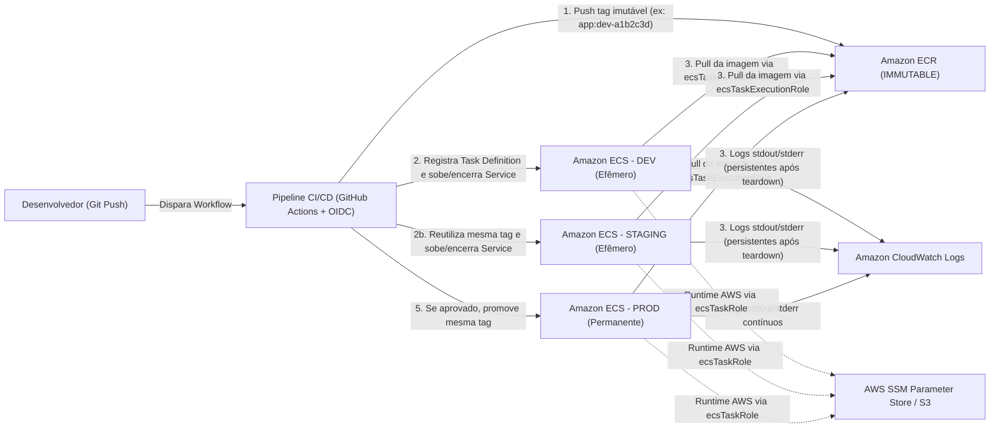

# Arquitetura Multi-Ambiente na AWS (Dev, Staging Efêmeros e Prod Permanente) com ECS, ECR e IAM

Repositório de portfólio focado em **Cloud Architecture, DevSecOps e FinOps na AWS**, demonstrando como construir um ciclo completo de entrega contínua com **artefatos imutáveis no Amazon ECR**, **ambientes efêmeros de `dev` e `staging` no Amazon ECS (Fargate)** e **segregação estrita das três identidades IAM**.

---

## Visão Geral da Arquitetura

Este projeto resolve três desafios clássicos de engenharia de plataforma:
1. **Imutabilidade de Artefatos ("Build Once, Deploy Anywhere")**: a mesma imagem gerada e testada uma única vez (`app:dev-<short_sha>`) percorre `dev`, `staging` e é promovida para `prod` sem reconstrução (`rebuild`).
2. **FinOps com Ambientes Efêmeros**: `dev` e `staging` sobem apenas durante a execução do pipeline e são encerrados ao final dos testes (`desired_count = 0` em `FARGATE_SPOT`), evitando custos de computação ociosos.
3. **Observabilidade e Auditoria Contínuas**: mesmo após o encerramento das tasks/services de `dev` e `staging`, a imagem permanece armazenada no **Amazon ECR** e todo o fluxo de `stdout`/`stderr` permanece salvo no **Amazon CloudWatch Logs**.



---

## As 3 Identidades IAM da Arquitetura

A separação rigorosa de privilégios garante que **a pipeline**, **o agente de infraestrutura do ECS** e **o código da aplicação** nunca compartilhem permissões entre si:

| Identidade IAM | Recurso no Terraform | Quem Assume | Responsabilidades Principais |
| :--- | :--- | :--- | :--- |
| **Identidade do Pipeline (CI/CD)** | `portfolio-app-cicd-pipeline-role` (`infra/terraform/iam.tf`) | GitHub Actions via **OIDC** (sem chaves estáticas) | Faz o build da imagem Docker, envia com tag única para o **ECR**, registra revisões da Task Definition, cria/atualiza Services/Tasks em `dev`, `staging` e `prod`, e **encerra `dev`/`staging`** ao final dos testes. Possui `iam:PassRole` restrito exclusivamente às duas roles do ECS. |
| **ECS Task Execution Role (`ecsTaskExecutionRole`)** | `portfolio-app-<env>-ecsTaskExecutionRole` (`infra/terraform/iam.tf`) | Agente do ECS / Infraestrutura Fargate (**Control Plane**) | Puxar a imagem privada do **Amazon ECR** (`ecr:GetAuthorizationToken`, `ecr:BatchGetImage`) e enviar os fluxos `stdout`/`stderr` do container para o **Amazon CloudWatch Logs** (`logs:CreateLogStream`, `logs:PutLogEvents`). |
| **ECS Task Role (`ecsTaskRole`)** | `portfolio-app-<env>-ecsTaskRole` (`infra/terraform/iam.tf`) | Código da aplicação dentro do container (**Data Plane / Runtime**) | Acessar recursos AWS necessários ao negócio em tempo de execução (ex.: leitura de parâmetros no **SSM Parameter Store** `/portfolio-app/<env>/*` e objetos no **Amazon S3** do respectivo ambiente), sem acesso ao ECR ou ao control plane do ECS. |

---

## Visão Geral do Fluxo (`dev` → `staging` → `prod`)

1. **Build e Push Imutável para o ECR**: o pipeline (`build-and-push-ecr`) roda os testes unitários da aplicação, assume a **Identidade do Pipeline (CI/CD)** via OIDC, constrói a imagem e faz o push para o Amazon ECR com tag única e imutável (ex.: `app:dev-a1b2c3d`).
2. **Provisionamento Efêmero em `dev` e `staging`**: o CI/CD registra uma nova revisão da Task Definition (`ecs/task-definition.dev.json` / `ecs/task-definition.staging.json`) apontando para essa tag exata e sobe o Service/Task no Amazon ECS (`desired-count 1`).
3. **Execução Controlada pelo ECS Agent**: o agente do ECS utiliza a **`ecsTaskExecutionRole`** para baixar a imagem privada do ECR e encaminhar `stdout`/`stderr` do container para o CloudWatch Logs (`/ecs/portfolio-app/dev` e `/ecs/portfolio-app/staging`). Enquanto isso, a aplicação recebe credenciais temporárias da **`ecsTaskRole`** caso precise acessar serviços AWS em runtime.
4. **Testes e Teardown dos Ambientes Efêmeros**: após validar `GET /health`, `GET /info` e os registros de logs no CloudWatch, o pipeline executa o teardown (`if: always()`) encerrando o Service/Task de `dev` e `staging` (`desired-count 0`). **A imagem permanece salva no ECR e os logs permanecem intactos no CloudWatch Logs** (`skip_destroy = true`).
5. **Promoção Imutável para Produção**: mediante aprovação no GitHub Environment `production`, o pipeline promove **a mesma tag de imagem validada** (`app:dev-a1b2c3d`) para o Service permanente de produção (`portfolio-app-prod-service`), realizando rolling update com zero downtime.

---

## Estrutura do Repositório

```text
.
├── .github/
│   └── workflows/
│       └── pipeline-cicd.yml          # Pipeline completo: Build/ECR -> DEV efêmero -> STAGING efêmero -> PROD
├── app/
│   ├── Dockerfile                     # Build multi-stage seguro (node:20-alpine, usuário não-root, HEALTHCHECK)
│   ├── package.json                   # Metadados e script de testes nativo (node --test)
│   ├── src/server.js                  # API HTTP (/health, /info, /simular-erro) com logs JSON em stdout/stderr
│   └── test/server.test.js            # Testes automatizados da aplicação
├── docs/
│   ├── arquitetura-iam-ecs.md         # Detalhamento das 3 IAM Roles e diagrama de sequência
│   └── fluxo-cicd-ambientes-efemeros.md # Ciclo de vida efêmero, FinOps e imutabilidade no ECR
├── ecs/
│   ├── task-definition.dev.json       # Template Task Definition de DEV
│   ├── task-definition.staging.json   # Template Task Definition de STAGING
│   └── task-definition.prod.json      # Template Task Definition de PROD
└── infra/
    └── terraform/
        ├── versions.tf                # Versões de Terraform/AWS Provider e tags padrão
        ├── variables.tf               # Variáveis parametrizadas por ambiente
        ├── ecr.tf                     # Repositório ECR imutável + scan on push + lifecycle policy
        ├── iam.tf                     # OIDC + Identidade CI/CD + ecsTaskExecutionRole + ecsTaskRole
        ├── logs.tf                    # CloudWatch Log Groups persistentes (skip_destroy = true)
        ├── network.tf                 # VPC isolada, subnets e Security Group Fargate
        ├── ecs.tf                     # Cluster ECS, Capacity Providers (FARGATE_SPOT/FARGATE) e Service
        ├── outputs.tf                 # ARNs das roles, ECR URL e nomes dos recursos
        └── environments/
            ├── dev.tfvars             # Configuração do ambiente efêmero de dev + recursos compartilhados
            ├── staging.tfvars         # Configuração do ambiente efêmero de staging
            └── prod.tfvars            # Configuração do ambiente permanente de produção
```

---

## Como Provisionar e Testar

### 1. Provisionar a Infraestrutura com Terraform

Provisione primeiro o ambiente `dev` (que também cria os recursos compartilhados: ECR, provedor OIDC e Role do Pipeline CI/CD) e em seguida `staging` e `prod`:

```bash
cd infra/terraform
terraform init

# Provisiona recursos compartilhados + ambiente efêmero de DEV
terraform workspace new dev || terraform workspace select dev
terraform apply -var-file="environments/dev.tfvars"

# Provisiona ambiente efêmero de STAGING
terraform workspace new staging || terraform workspace select staging
terraform apply -var-file="environments/staging.tfvars"

# Provisiona ambiente permanente de PROD
terraform workspace new prod || terraform workspace select prod
terraform apply -var-file="environments/prod.tfvars"
```

### 2. Configurar o GitHub Actions

1. Nos segredos do repositório GitHub, configure `AWS_CICD_ROLE_ARN` com o output `cicd_pipeline_role_arn` retornado pelo Terraform.
2. Em **Settings → Environments**, crie os environments `dev`, `staging` e `production` (adicionando revisores obrigatórios em `production`).

### 3. Testar a Aplicação Localmente com Docker

```bash
docker build -t app:dev-local ./app
docker run --rm -p 3000:3000 -e APP_ENV=dev -e IMAGE_TAG=dev-local app:dev-local
```

Acesse `http://localhost:3000/health` ou `http://localhost:3000/info` para inspecionar a resposta e os logs JSON emitidos no console.

---

## Documentação Complementar

- [Arquitetura IAM no ECS: Pipeline CI/CD vs Execution Role vs Task Role](docs/arquitetura-iam-ecs.md)
- [Fluxo CI/CD, Ambientes Efêmeros e Imutabilidade no ECR](docs/fluxo-cicd-ambientes-efemeros.md)
