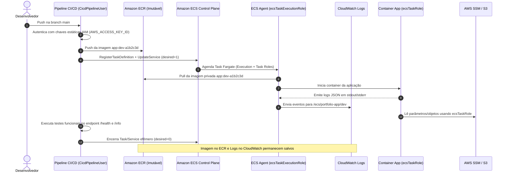

# Arquitetura de Identidades IAM: CI/CD, Execution Role e Task Role

A separação correta de permissões no Amazon ECS é um dos pontos mais avaliados em arquiteturas Cloud seguras. Confundir a **`ecsTaskExecutionRole`** com a **`ecsTaskRole`** — ou conceder privilégios excessivos ao pipeline — amplia drasticamente a superfície de ataque.

Este documento detalha como as três identidades funcionam em conjunto neste projeto.

---

## Diagrama de Sequência das Identidades

---

## Comparativo Técnico das Três Identidades

| Critério | Identidade do Pipeline (CI/CD) | ECS Task Execution Role (`ecsTaskExecutionRole`) | ECS Task Role (`ecsTaskRole`) |
| :--- | :--- | :--- | :--- |
| **Nome no Terraform** | `portfolio-app-cicd-pipeline-user` | `portfolio-app-<env>-ecsTaskExecutionRole` | `portfolio-app-<env>-ecsTaskRole` |
| **Tipo de Autenticação / Trust** | Usuário IAM com Chaves Estáticas (`AWS_ACCESS_KEY_ID` / `AWS_SECRET_ACCESS_KEY`) | `ecs-tasks.amazonaws.com` | `ecs-tasks.amazonaws.com` |
| **Plano de Atuação** | Automação / Entrega Contínua | Control Plane do ECS (Agente / Daemon) | Data Plane (Código da Aplicação) |
| **Ações Permitidas** | `ecr:PutImage`, `ecs:RegisterTaskDefinition`, `ecs:CreateService`, `ecs:UpdateService`, `ecs:DeleteService`, `ecs:RunTask`, `ecs:StopTask`, `iam:PassRole` | `ecr:GetAuthorizationToken`, `ecr:BatchGetImage`, `ecr:GetDownloadUrlForLayer`, `logs:CreateLogStream`, `logs:PutLogEvents` | `ssm:GetParameter*` em `/portfolio-app/<env>/*` e `s3:GetObject`/`PutObject` no prefixo `<env>/*` |
| **Privilégios Bloqueados** | Não tem acesso direto a dados da aplicação no S3/SSM | Não cria/deleta services ECS e não lê dados de negócio da aplicação | Não pode puxar imagens do ECR, não gerencia ECS e não acessa outros ambientes |

---

## Controles de Segurança Aplicados em `infra/terraform/iam.tf`

1. **Chaves Estáticas com Menor Privilégio no CI/CD**: o usuário IAM do pipeline (`portfolio-app-cicd-pipeline-user`) autentica via `AWS_ACCESS_KEY_ID` e `AWS_SECRET_ACCESS_KEY` armazenadas nos Secrets do GitHub Actions, com escopo restrito às operações de ECR e ECS do projeto.
2. **`iam:PassRole` Restrito**: a identidade do pipeline só pode anexar roles às tasks do ECS quando o destino for `ecs-tasks.amazonaws.com` (`Condition: iam:PassedToService`) e exclusivamente para os padrões de ARN `portfolio-app-*-ecsTaskExecutionRole` e `portfolio-app-*-ecsTaskRole`.
3. **Proteção contra Confused Deputy**: as trust policies das roles de ECS validam `aws:SourceAccount` garantindo que apenas tasks da própria conta AWS possam assumi-las.
4. **Isolamento por Ambiente no Data Plane**: a `ecsTaskRole` de `dev` só enxerga parâmetros `/portfolio-app/dev/*`, impedindo que uma task de teste acesse segredos ou buckets de `prod`.

