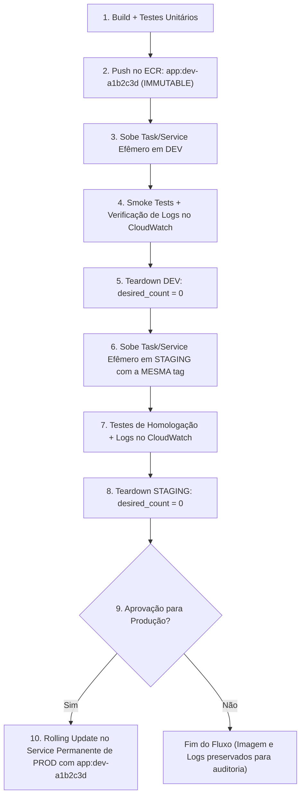

# Fluxo CI/CD, Ambientes Efêmeros e Imutabilidade no ECR

Este documento detalha o ciclo de vida das entregas entre **dev**, **staging** e **prod**, explicando como a arquitetura concilia **economia de infraestrutura (FinOps)**, **rastreabilidade** e **confiabilidade no deploy**.

---

## Ciclo de Vida da Imagem Imutável

---

## Comparativo entre Ambientes Efêmeros e Permanente

| Característica | `dev` (Efêmero) | `staging` (Efêmero) | `prod` (Permanente) |
| :--- | :--- | :--- | :--- |
| **Capacity Provider** | `FARGATE_SPOT` | `FARGATE_SPOT` | `FARGATE` |
| **Estado Fora da Janela de Pipeline** | `desired_count = 0` (sem tasks em execução) | `desired_count = 0` (sem tasks em execução) | `desired_count = 2` (alta disponibilidade contínua) |
| **Tag da Imagem Utilizada** | `app:dev-<short_sha>` | Exata mesma `app:dev-<short_sha>` | Exata mesma `app:dev-<short_sha>` |
| **Grupo de Logs no CloudWatch** | `/ecs/aws-ecs-ephemeral-environments/dev` (14 dias) | `/ecs/aws-ecs-ephemeral-environments/staging` (30 dias) | `/ecs/aws-ecs-ephemeral-environments/prod` (90 dias) |
| **Após Término dos Testes** | Service/Task encerrado automaticamente (`if: always()`) | Service/Task encerrado automaticamente (`if: always()`) | Mantido ativo com rolling update zero-downtime |

---

## Garantias de Persistência Pós-Teardown

Mesmo quando o pipeline encerra os ambientes de `dev` e `staging` ao final dos testes:

1. **A Imagem Continua no Amazon ECR**:
   - Configurada com `image_tag_mutability = "IMMUTABLE"` em `infra/terraform/ecr.tf`.
   - Ninguém consegue sobrescrever a tag `dev-a1b2c3d`.
   - A política de ciclo de vida (`aws_ecr_lifecycle_policy`) preserva as 50 versões imutáveis mais recentes para rastreabilidade, diagnóstico e rollback imediato.

2. **Os Logs Continuam no Amazon CloudWatch Logs**:
   - Configurados em `infra/terraform/logs.tf` com `skip_destroy = true`.
   - Como o agente do ECS envia continuamente `stdout` e `stderr` para o CloudWatch Logs por meio da `ecsTaskExecutionRole` enquanto a task está rodando, o encerramento da task (`desired-count 0`) **não apaga** os logs gerados durante os testes.
   - Engenheiros conseguem auditar falhas em execuções efêmeras mesmo horas ou dias depois de as tasks terem sido destruídas.

